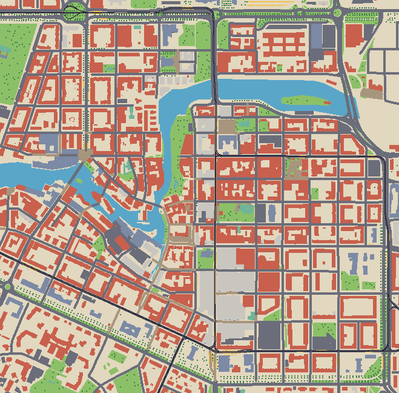

# The Racer — Norrköping

A cosy 2D top-down arcade racer set in central Norrköping, Sweden, built with Phaser 4, Vite and TypeScript.
The map is generated from OpenStreetMap: the city grid bounded by Kungsgatan, Södra Promenaden, Östra Promenaden
and Norra Promenaden, with Motala ström running through it.



## Quick start

Requires Node 20+.

```bash
npm install
```

```bash
npm run dev
```

Open the URL Vite prints (default http://localhost:5173).

The generated map, the cached OSM data and the placeholder art are all committed, so the game runs offline straight
after `npm install`.

### Controls

| Key | Action |
| --- | --- |
| ↑ / W | Accelerate |
| ↓ / S | Brake, then reverse |
| ← → / A D | Steer |
| Space | Handbrake (drift) |
| N | Toggle night (also `?night` in the URL) |
| R | Reset to start |
| C | Credits |

## Regenerating the map

```bash
npm run fetch-map
```

This rebuilds `public/assets/maps/norrkoping.json` from the cached Overpass response in `data/osm-cache.json`.
No network access needed.

To pull fresh data from OpenStreetMap (Overpass API) and overwrite the cache:

```bash
npm run fetch-map -- --refresh
```

What the script does:

1. Looks up the four boundary streets in Overpass and fetches roads, buildings, water, parks and trees in a box
   around them.
2. Detects the dominant street-grid angle (about 15°) and rotates the world so streets line up with the tile grid.
3. Frames the map on the four streets (+30 m margin) and rasterizes it to 16×16 px tiles at 2.25 m per tile
   (≈ 659 × 648 tiles). Roads are widened (9–11 m) so they're drivable.
4. Autotiles roads with a 4-bit neighbour mask (straights, corners, T-junctions, crossings). Outer corners are cut
   diagonally, so diagonal streets get smooth 45° curbs instead of staircases.
5. Styles buildings from their OSM tags (residential, church, civic, industrial, commercial) and draws them in
   3/4 view (roof + two facade rows). Restaurant, café, bar and shop nodes get an awning on the nearest visible
   facade, or outdoor tables if there isn't one. Churches get a steeple.
6. Adds Norrköping's trams: tram tracks (`railway=tram`, with line numbers from the route relations), stops
   (`railway=tram_stop`) with a stop sign, platforms with a yellow tactile edge, and a deck where tracks cross water
   on their own bridge. Tram/bus-only streets (`highway=service` with rails or bus lanes) are drivable.
7. Places street lamps: the few mapped in OSM (`highway=street_lamp`), plus generated ones every ~24 m on
   alternating sides of every street not tagged `lit=no`, just outside the curb.
8. Writes a Tiled-compatible JSON map with `ground` and `decor` tile layers, an `objects` layer (spawn point), a
   `streets` layer (named roads as polylines, squares as polygons, used for the street sign in the HUD) and a
   `tram` layer (track centrelines as polylines, stops as points) and a `lights` layer (street lamps as points,
   `source` = `osm` or `generated`; move or delete them freely in Tiled).
9. Writes `data/map-preview.png` (one pixel per tile) so you can check the result quickly.

Tunables (tile size in metres, margin, road widths, storefront search radius) are at the top of
`scripts/fetch-map.ts`. Which OSM tags become which building style or storefront is in `scripts/lib/buildings.ts`.

## Height data (optional)

Terrain heights come from Lantmäteriet's 1 m ground model ("Markhöjdmodell Nedladdning, grid 1+", free,
CC BY 4.0). The tile search is public, but downloading the heights needs a Geotorget account:

1. Create an account at [Geotorget](https://geotorget.lantmateriet.se/) and order
   **Markhöjdmodell Nedladdning, grid 1+** (free of charge).
2. Put the account's login in `.env.local` in the project root (it's git-ignored, so it never gets committed):

   ```
   LANTMATERIET_USER=your-username
   LANTMATERIET_PASSWORD=your-password
   ```

3. Run:

   ```bash
   npm run fetch-height
   ```

This reads only the part of each 2.5 km height tile that the map covers, samples it onto the map's tile grid
(same projection and rotation), and writes `data/height.json` (decimetres, committed so everything works
offline) plus `data/height-preview.png` (shaded relief). Rerun it after changing the map frame or tile size.

## Replacing the placeholder art

The tileset, car sprite and pixel font are generated by:

```bash
npm run gen-placeholders
```

It only writes files that don't exist yet, so once you've drawn your own art it won't be overwritten
(`-- --force` regenerates everything).

- `public/assets/tiles/tiles.png` — 16 columns × 6 rows of 16×16 tiles:
  - row 0: ground and decor (grass, flowers, sidewalk, water, quay, small tree, café tables, steeple, 2×2 big tree)
  - rows 1–2: asphalt and cobblestone roads, where the column is the neighbour mask N=1, E=2, S=4, W=8 (set bit =
    the road continues that way)
  - row 3: diagonal road edges (asphalt then cobblestone; NE, SE, SW, NW)
  - row 4: roofs, then upper facades, per building style (residential, church, civic, industrial, commercial)
  - row 5: street-level facades: the five styles, then restaurant, café, bar, shop
  - row 6: tram/bus platforms (neighbour mask, like roads)

  Tram rails aren't tiles. The game draws them as 1px lines from the `tram` layer at true standard gauge, with
  sleepers where the track isn't set into a street. Colours are `rail`, `railDark` and `sleeper` in
  `src/game/palette.ts`.

  Keep this layout, or update `src/game/tiles.ts`. Every tile has a `name` property in the Tiled tileset.
- `public/assets/sprites/car.png` — 16×16, facing east (right).
- `public/assets/sprites/street-lamp.png`: 8×24, foot of the post at row 21.
- `public/assets/lights/{round,small,cone}.png`: greyscale light shapes for night mode (white = full light,
  tinted in code). `cone` is the headlight beam, with its origin at the middle of the left edge.
- `public/assets/fonts/pixel-font.png` — 4×7 cells, character order in `src/game/font.ts`.

The map opens in [Tiled](https://www.mapeditor.org/) (`public/assets/maps/norrkoping.json`). Each tile in the tileset
carries a `surface` property (`asphalt`, `cobble`, `paving`, `grass`, `water`, `building`, `tree`), which the game
uses for grip and collision — change it in Tiled's tileset editor to change how a tile drives. Bear in mind that
`npm run fetch-map` overwrites the map, so hand edits belong in a separate file for now.

## Surfaces

| Surface | Grip | Top speed | Notes |
| --- | --- | --- | --- |
| Asphalt | high | 190 | |
| Cobblestone | medium | 150 | slight rumble |
| Sidewalk / paving | medium | 120 | |
| Grass | low | 85 | slides a lot |
| Tram rails | ×0.7 of the surface they're on | — | rattle |
| Building, water, tree | — | — | solid |

Speeds are in px/s. The HUD converts them to km/h using the map's `metresPerTile`. Values are in
`src/game/surfaces.ts`.

## Scripts

| Command | What it does |
| --- | --- |
| `npm run dev` | Vite dev server |
| `npm run build` | Typecheck and production build to `dist/` |
| `npm run preview` | Serve the production build |
| `npm run typecheck` | TypeScript only |
| `npm run fetch-map` | Rebuild the map from cache (`-- --refresh` to re-query Overpass) |
| `npm run gen-placeholders` | Write missing placeholder PNGs (`-- --force` to overwrite) |

## Credits and licence

Height data © [Lantmäteriet](https://www.lantmateriet.se/), Markhöjdmodell Nedladdning grid 1+, licensed under
[CC BY 4.0](https://creativecommons.org/licenses/by/4.0/). `data/height.json` is derived from it (resampled to
the map grid).

Map data © [OpenStreetMap contributors](https://www.openstreetmap.org/copyright), available under the
[Open Database License (ODbL)](https://opendatacommons.org/licenses/odbl/). The generated map and the cached
Overpass response in this repository are derived from OpenStreetMap data and fall under the ODbL. Attribution is
shown in the game's corner, on the credits screen (press C) and under the canvas.

Map data comes from OpenStreetMap only. Don't use Google Maps or similar sources: their terms forbid deriving
map data.

Built with [Phaser 4](https://phaser.io/).
